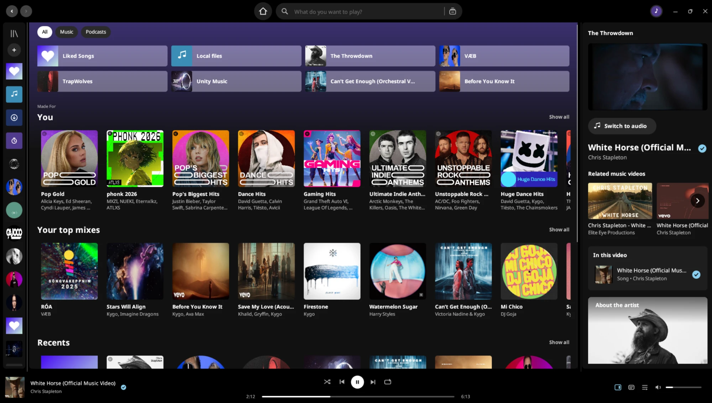
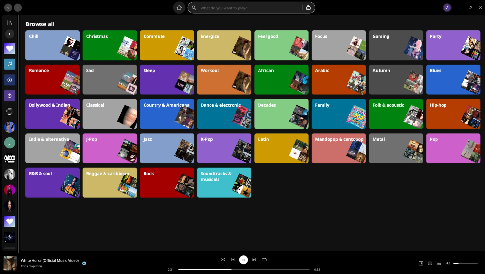
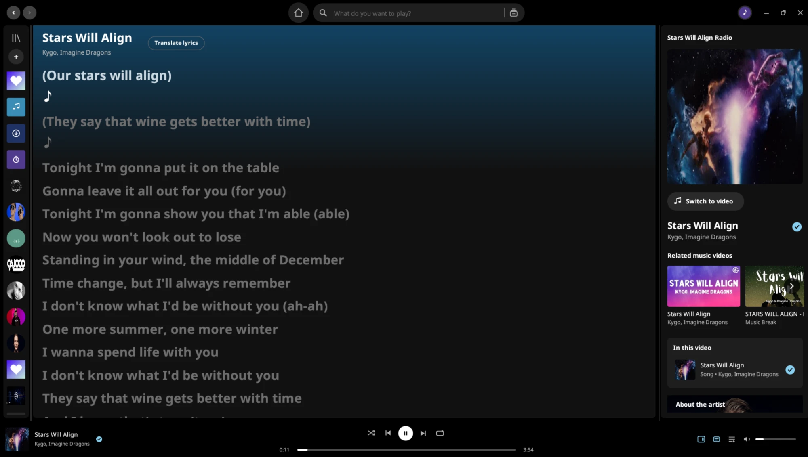

<div align="center">


# Senthym

---

### A Spotify-style music player for Linux, Windows and macOS, written in Rust.

Search and stream from YouTube Music, Deezer and SoundCloud with no ads, no subscription and no API keys. Your own files, synced lyrics and official music videos too.

**Your Music. Your Freedom.**

[](https://github.com/fabox-os/Senthym/actions)
[](https://github.com/fabox-os/Senthym/releases/latest)
[](LICENSE)
[](https://www.rust-lang.org/)
[](#download)
[](https://discord.gg/6VjX67S67d)

[](https://www.opensourcealternatives.to)

[Website](https://fabox-os.github.io/Senthym/) • [Download](#download) • [Discord](https://discord.gg/6VjX67S67d) • [Features](#features) • [How it works](#how-it-works) • [Updates](#updates) • [Build from source](#building-and-running) • [Architecture](#project-layout) • [Roadmap](ROADMAP.md) • [Changelog](CHANGELOG.md) • [Contributing](#contributing)

<br>



</div>

---

Senthym is a desktop music player for Linux, Windows and macOS. It is written in Rust and draws its own fast, modern
interface with [egui](https://github.com/emilk/egui). You search for any song, artist, album or playlist and
it plays right away, with no ads, no subscription and no tracking. It also plays your own music files, shows
synced lyrics and, when a song has an official music video, plays the video too.

Senthym uses a **Spotify-style interface** on purpose, so it is simple to use from the first minute: a
library on the left, the song bar at the bottom, the Now Playing panel on the right. If you have used
Spotify, you already know where everything is. It has its own dark look with a baby-blue accent (`#89CFF0`).

---

**NOTE:** Senthym was designed and tested on **Linux (Ubuntu 26.04.1 LTS)**. It is tested on **Windows** too, and also runs on **macOS**, which gets less testing. If you find a bug on any system, please **open an issue**.

---

## Features

- **Instant playback.** Songs are fetched fast and prepared before you press play: what you hover over, what is on screen and what plays next. Queue, shuffle, repeat and a listening history included.
- **Three sources, no keys.** YouTube Music is set up out of the box; Deezer and SoundCloud are searched alongside it, merged so each song appears once. No account and no API key. Spotify can be added optionally with your own key.
- **Search that gets out of the way.** Suggestions as you type, recent searches with covers, Browse all with genre and mood tiles, and keyboard navigation.
- **Music videos up to 1080p.** The official video, or the artist's live, acoustic or sessions film when there is no studio video, always checked against the song. Switch between video and audio at the same moment, with a mini player, full screen and related videos over the picture.
- **Quality that follows you.** Auto by default, or a fixed 1080p down to 240p. A change lands in a fraction of a second and never freezes the picture.
- **Never stuck on a broken song.** If a song can't be fetched, Senthym tries SoundCloud and another upload at once instead of skipping it, and tells you where it came from.
- **Synced lyrics.** Line-by-line lyrics that follow the song, translated into your language, and kept in time even when a video opens with a scene before the music.
- **A library that is yours.** Playlists with your own name, description and cover; Liked Songs, followed artists and saved albums together, as a rail or a full grid; a Follow button for every credited artist.
- **Hide in this playlist.** A song stays in the list, greyed out, and is skipped when it is time to play, in every playlist, Liked Songs included, with an Undo.
- **Autoplay that knows your taste.** When the queue ends, songs are blended from the radios around what you actually chose, adapting within a couple of songs and resting artists you skip.
- **Your own files, downloads and crossfade.** Play music from your computer next to the online library, download songs for offline listening and blend one song into the next with an adjustable crossfade.
- **Spotify-style interface.** A library on the left, the song bar at the bottom and the Now Playing panel on the right, with its own dark look, a baby-blue accent and a modern window frame.
- **Updates inside the app.** Settings → Updates downloads the right package, checks it, installs it and reopens Senthym with your library and sign-in kept.
- **Private by design.** No ads, no analytics, no tracking. Your library, settings and sign-in stay on your computer, and every download is checked before it is used.
- **Runs everywhere.** Linux (x86_64 and ARM64: `.deb`, `.rpm`, AppImage, Flatpak), Windows (one `.exe`) and macOS (universal `.dmg`).

---

## Screenshots

**Browse all**



**Synced lyrics**



---

## How it works

Senthym comes **already set up with YouTube Music**. Open the app, type a song and press play. There is
nothing to configure, no account to create and no key to enter.

- **YouTube Music** is the main source: search, albums, artists, playlists, radio and related music videos.
- **Deezer** and **SoundCloud** are searched alongside it, so you also find songs, remixes and tracks that
  only exist there. Their results appear together with the others.
- When you press play, Senthym's built-in streaming engine fetches the song and plays it through its own
  audio player, which is why crossfade, volume, seeking and lyrics work the same for every source.
- If the song has an official music video, Senthym finds it and plays the picture in sync with the sound; you
  can switch between the video and the audio version at any time.

You can also sign in to bring in your own library, and optionally connect Spotify (see **Music sources**
below).

---

## Music sources

Senthym brings several services together in one place, and **none of them needs an API key**:

- **YouTube Music**
- **SoundCloud**
- **Deezer**

Search, albums, artists and playlists work out of the box. You don't have to create an account or register
anything.

**Spotify (optional):** if you want your Spotify library inside Senthym too, you can set up your own Spotify
API key (a client ID from the Spotify developer dashboard) in **Settings → Accounts → Spotify (optional)**. It is entirely optional;
everything else works without it.

---

## Updates

Senthym tells you when a new release is out and updates itself from
[the Releases page](https://github.com/fabox-os/Senthym/releases). Open **Settings → Updates** and press
**Check for updates**, or use the notice that appears when you start the app (it can be turned off in the
same place).

It downloads the package that matches how you installed Senthym (Flatpak, AppImage, `.deb`, `.rpm`, Windows
`.exe` or macOS `.dmg`), checks it against the checksum GitHub publishes, installs it, closes the app and
opens the new version. Your library, playlists, sign-in and settings stay as they were: they live in your
data folder, not in the program. Senthym keeps a copy of your library before every update.

---

## Keyboard shortcuts

| Keys | Action |
| --- | --- |
| Space | Play / pause |
| Ctrl + → / Ctrl + ← | Next / previous song |
| Ctrl + F or Ctrl + L | Focus the search box |
| Alt + ← / Alt + → | Back / forward |

---

## Download

Ready-made packages are on the [Releases page](https://github.com/fabox-os/Senthym/releases):

| System | Package |
| --- | --- |
| Debian / Ubuntu (x86_64) | `Senthym-linux-amd64.deb` |
| Debian / Ubuntu (ARM64) | `Senthym-linux-arm64.deb` |
| Fedora / openSUSE (x86_64) | `Senthym-linux-x86_64.rpm` (install `ffmpeg` too) |
| Fedora / openSUSE (ARM64) | `Senthym-linux-aarch64.rpm` (install `ffmpeg` too) |
| Any Linux (x86_64 / ARM64) | `Senthym-linux-x86_64.AppImage` / `Senthym-linux-aarch64.AppImage` (ffmpeg included) |
| Any Linux (x86_64 / ARM64) | `Senthym-linux-x86_64.flatpak` / `Senthym-linux-aarch64.flatpak` (ffmpeg included) |
| Windows | `Senthym-windows.exe` |
| macOS (Apple silicon + Intel) | `Senthym-macos-universal.dmg` |

--- | --- |
| Debian / Ubuntu | `Senthym-linux-amd64.deb` |
| Fedora / openSUSE | `Senthym-linux-x86_64.rpm` (install `ffmpeg` too) |
| Any Linux | `Senthym-linux-x86_64.AppImage` (ffmpeg included) |
| Any Linux | `Senthym-linux.flatpak` (ffmpeg included) |
| Windows | `Senthym-windows.exe` |
| macOS (Apple silicon + Intel) | `Senthym-macos-universal.dmg` |

---

## Building and running

Senthym runs on **Linux** (Wayland and X11), **Windows** and **macOS**.

- **Windows:** one file, `senthym.exe`. Double-click it. The first time, it fetches the video decoder
  (ffmpeg) by itself, checked against its published checksum.
- **macOS:** one universal app (`Senthym.app` in a `.dmg`) that runs natively on Apple silicon and Intel
  Macs. It is not notarized by Apple, so the first time use right-click → Open.
- **Linux:** build from source below.

The Windows and macOS packages are built by the GitHub Actions workflow in `.github/workflows/build.yml`
(run it from the Actions tab, or push a `v*` tag), and the results are downloadable from the run.

**To build from source you need:**

- Rust (stable) and Cargo
- `ffmpeg` on your `PATH` (Linux only; it decodes the music-video picture)
- Working sound output (ALSA, PulseAudio or PipeWire)

```bash
cd app
cargo build --release
./target/release/senthym
```

The first time you play an online song, Senthym sets up its streaming engine on its own and keeps it up to
date; you don't have to install anything else.

**Handy options for testing:**

```bash
# Draw the interface to a PNG and exit (pages: search, library, player, lyrics, queue, settings, liked, ...)
./target/release/senthym --screenshot out.png --page library

# Use a separate data folder, for example a copy of your library
SENTHYM_HOME=/tmp/senthym-test ./target/release/senthym
```

---

## Where your data lives

| What | Where |
| --- | --- |
| Library, playlists, settings | `~/.local/share/senthym` |
| Song and picture cache | `~/.cache/senthym` |
| Downloads | `~/Music/Senthym` (changeable in Settings) |
| Crash report (only if the app panics) | `~/.local/share/senthym/crash.log` |

If you used an earlier version under another name, your library and cache are moved over automatically the
first time Senthym starts.

---

## Privacy and safety

- No ads, no analytics, no tracking.
- Your library, settings and sign-in files stay on your computer.
- Downloads of the streaming engine are checked with a SHA-256 checksum before use.
- The video decoder only reads secure (`https`) addresses, and picture and memory sizes are capped.
- If something does go wrong, a crash report is written locally so it can be fixed.

---

## Project layout

```
app/
  src/main.rs         start-up, window, icon, crash log, screenshot mode
  src/app.rs          application state, actions and background-work messages
  src/store.rs        saved library and settings, data folders and migration
  src/audio/          audio engine (decks, crossfade, leveller) and decoding
  src/video.rs        music-video picture pipeline
  src/ui/             screens, widgets, player bar, video views
  src/images.rs       cover pictures, cache and memory limit
  assets/             app icons
  ROADMAP.md          what is done and what is planned
  CHANGELOG.md        what changed
```

---

## Contributing

Issues and pull requests are welcome, and you can chat with the community on [Discord](https://discord.gg/6VjX67S67d). To report a bug, open an issue and say which system you use (Linux,
Windows or macOS) and which package; for Windows and macOS this matters most, since those builds get less
testing. To work on the code:

```bash
cd app
cargo build --release     # build
cargo test --release      # unit tests
```

Keep a change small and say how you checked it. The layout of the code is in [Project layout](#project-layout),
what is planned is in the [Roadmap](ROADMAP.md) and what changed is in the [Changelog](CHANGELOG.md).

---

## Roadmap

See [ROADMAP.md](ROADMAP.md) for finished work and what comes next (packaging as AppImage / .deb, per-song
video quality, account follow sync, long-run performance tests) and [CHANGELOG.md](CHANGELOG.md) for the
history of changes.

---

## License

Senthym is free software under the [GNU GPL v3](LICENSE).
